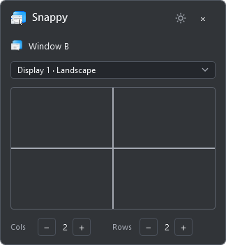

# Snappy 0.5.0

Free, offline window snapping for Windows. MIT licensed. No account, subscription,
trial timer, telemetry, or administrator requirement.

[Download Snappy for Windows x64](https://github.com/flymywings/Snappy/releases/latest)



## Appearance

Compact charcoal panel with a fixed **90% opaque background**, fully opaque text,
icons, controls, and gray grid lines, plus a soft blue hover/selection highlight.
Halfway dividers are 2 DIP thick when the corresponding row/column count is even;
ordinary guides are 1 DIP. No thirds are emphasized. Dropdown menus stay opaque.
The header uses capital **Snappy**; typography
uses Segoe UI Variable with Segoe UI fallback. No extra font installation is needed.
Rows/columns sit in a slim strip below the grid, and status appears only for errors
or pause. The custom caption can be dragged; its close button hides to the tray.

The approved soft window-and-cursor artwork is used by the executable, window,
header, and tray. Its master is `src/Snappy.Windows/Assets/Snappy-source.png`:
blue destination pane, app-like window content, gray window controls, and a lower
cursor with a crisp outline and no external glow. Transparent PNG exports at
16–256 px and a nine-resolution ICO are generated from that exact master.
The source hash and export bounds are recorded in `Snappy-export.json`.
Regenerate exports:

```powershell
dotnet run --project tools/IconTool -- src/Snappy.Windows/Assets/Snappy-source.png src/Snappy.Windows/Assets
```

The tool removes empty margins and detached generation specks from the export
viewport, fits the connected artwork uniformly, and retains the master unchanged.
Older vector concepts are archived in `docs/icon-history/v0.4`; they are no longer
the active brand source. This release changes icons, not the snapping workflow.

## Open, select window, click to snap

1. Extract the **entire** Windows x64 ZIP to a permanent folder. Exit any older
   Snappy copy from its tray icon, then run `Snappy.exe`.
2. Set **Cols** and **Rows** with the minus/plus buttons. Changes save immediately.
3. Click the application window you want to resize. Its name appears in Snappy.
4. Click a grid cell. That window fills the cell. Drag across multiple cells to
   fill a larger rectangle.
5. Click another application window and repeat. The panel stays open.

For portrait halves, choose **1 column × 2 rows**. For landscape halves, choose
**2 columns × 1 row**. Those are the defaults for new settings. Upgrading retains
existing layout dimensions; adjust the main panel directly to change them.

Snappy's panel stays above ordinary windows. Clicking its grid does not activate
Snappy or replace the selected application. The monitor selector follows the
selected window; select another monitor to place that window there instead.
Selecting another application follows its monitor again.

Close hides the panel to the notification area. Double-click its tray icon,
choose **Show grid**, press **Ctrl+Alt+Space**, or run Snappy again to reveal it.
Use the tray menu to pause snapping or exit the app.

The portable package includes .NET. No separate runtime installation is needed.
The build is unsigned. The app includes its own Snappy notification icon.

## Advanced

The gear opens the detailed layout editor. Existing saved layouts, zone shortcuts,
gaps, launch-at-sign-in preference, and Shift-drag toggle live there. Main-panel
steppers are disabled while Advanced is open so two editors cannot overwrite work.

- **Simple grids:** each cell is also a Shift-drag zone. Grid changes are saved
  per monitor and orientation. Existing custom layouts and shortcuts are preserved
  when a separate simple-grid layout is created. Advanced customization marks a
  generated layout as custom so subsequent simple-grid changes retain that layout.
- **Shift-drag:** hold Shift while dragging a window's title bar, then release the
  mouse over a zone. Releasing Shift or pressing Esc cancels snapping for the rest
  of that drag. Uncovered areas keep ordinary movement.
- **Custom layouts:** New/Duplicate a layout, choose 1–24 rows/columns, and Update
  grid. Select a rectangle, name it, optionally record a shortcut, and Add zone.
  Zones cannot overlap. Select a saved zone to edit it, then Update. Save changes
  commits the draft; Cancel discards it. Commit field edits before switching layouts.
- **Shortcuts:** optional zone shortcuts work when their layout is active on the
  selected window's monitor. Combinations must be unique across layouts. Conflicts
  keep previous working bindings. Backspace/Delete clears a zone shortcut.
- **Gaps:** 0–64 device-independent pixels, scaled for monitor DPI; zero by default.

Layouts can be shared by monitors. Duplicate before editing if only one monitor
should change. Disconnected-monitor assignments are retained.

Snappy leaves Windows snapping settings unchanged. Pause other managers that use
Shift-drag while trying Snappy. Windows that are elevated, non-resizable, hidden,
minimized, or too large for a zone's minimum size cannot be snapped. Errors appear
inside the panel, or as a tray notification when the panel is hidden. Snappy does
not resize neighboring windows or automatically arrange applications on startup.

## Settings and startup

Settings are at `%LOCALAPPDATA%\Snappy\settings.json`. Atomic writes keep the
previous valid file as `.bak`; corrupt files are preserved during recovery.
Unsupported future schemas are not overwritten. Panel position and grids persist.

Launch at sign-in defaults off. Enabling it adds a per-user `Snappy` value under
`HKCU\Software\Microsoft\Windows\CurrentVersion\Run`. Disable it before moving
or removing the portable folder. `--background` starts with the panel hidden.

## Build and test

Install the free .NET 10 SDK. From this directory:

```powershell
dotnet restore Snappy.slnx --configfile NuGet.Config
dotnet test Snappy.slnx -c Release --no-restore
dotnet build Snappy.slnx -c Release --no-restore
dotnet run --project src/Snappy.Windows
```

Create the self-contained ZIP and checksum:

```powershell
.\build.ps1
```

Outputs: `artifacts/Snappy-0.5.0-win-x64.zip`, portable folder, and SHA256SUMS.txt.
Builds need NuGet access. The finished app works offline. CI tests and packages
without creating public releases.

Native verification creates only test windows and writes a JSON report and PNGs:

```powershell
.\artifacts\Snappy-win-x64\Snappy.exe --self-test "$PWD\verification\native-smoke-v5.json"
```

`passed: null` means skipped, not successful. The harness drives grid selection
handlers with logical coordinates; physical pointer and external foreground
interaction remain manual checks. See `verification/RESULTS-v5.md` and CHECKLIST.md.

## Architecture and limits

`Snappy.Core` holds platform-independent geometry, settings, target selection,
simple-grid generation, drag state, placement orchestration, and hotkey staging.
`Snappy.Windows` supplies WPF UI, foreground tracking, and Windows adapters.
`Snappy.Tests` covers core behavior. Future OS ports need their own UI/adapters.

Windows 10 22H2 and Windows 11 x64 are intended targets. The available native test
host is Windows 10 with one landscape display; physical portrait/mixed-DPI and
Windows 11 validation are still outstanding. No public project/trademark clearance,
hosting deployment, or code signing was performed.

Cross-platform binaries, automatic tiling, app rules, overlapping zones, and
shared-divider resizing are outside this release.
